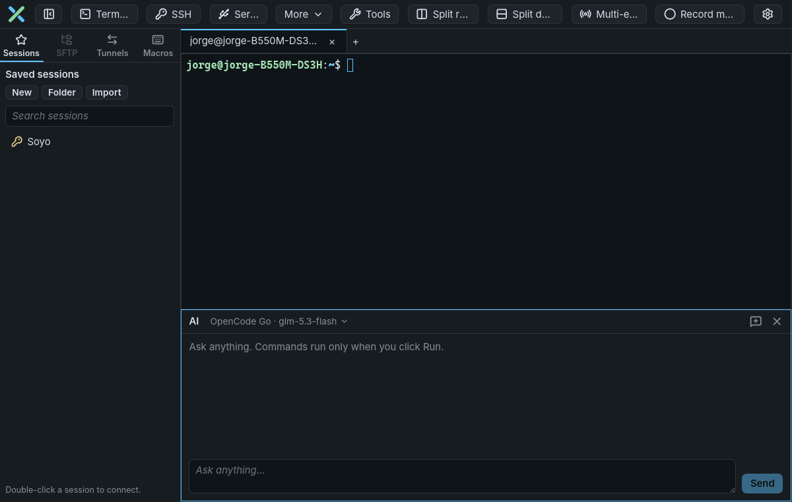
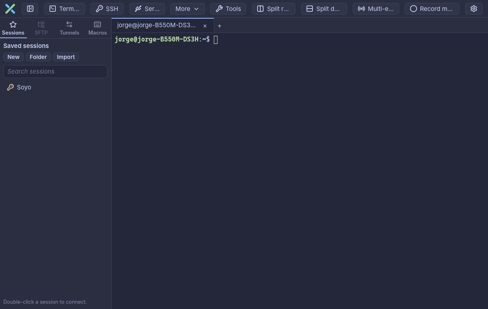

<p align="center">
  <picture>
    <source media="(prefers-color-scheme: dark)" srcset="assets/brand/plexusterm-mark.svg">
    
  </picture>
</p>

<h1 align="center">
  <picture>
    <source media="(prefers-color-scheme: dark)" srcset="assets/brand/plexusterm-wordmark.svg">
    
  </picture>
</h1>

<p align="center">
  <strong>A terminal and remote-session manager for Linux and Windows, with an AI assistant built in.</strong><br>
  Local shells, SSH, SFTP, tunnels, serial, Telnet and Mosh in one window.
</p>

<p align="center">
  
</p>

PlexusTerm is a native terminal and remote-session manager for Linux and Windows (tabs and split panes, a saved-session library, an SFTP browser next to each SSH tab, port forwards, serial consoles, macros) and adds an **AI chat next to every terminal** that explains, diagnoses and suggests commands. It is a clean-room implementation built with Tauri 2 (Rust), React/TypeScript and xterm.js, and speaks ten languages.

## Quick path

1. [Download](#install) the package for your system and install it.
2. Press **Ctrl+Shift+T** for a local terminal, or **Ctrl+Shift+S** to connect over SSH (`user@host:port`).
3. Press **Ctrl+Shift+Space** (or click the PlexusTerm X) to open the AI chat under the terminal. Add an API key in Settings → AI first.

## AI assistant

The AI is optional: nothing reaches an AI provider until you add a key. Once set up, it works in two places:

| Where | What it does | How you use it |
| --- | --- | --- |
| **AI chat** | A pane under the terminal that answers any question in your language: explanations, steps, what an error means. When a command fits, it offers one with **Copy**, **Insert** (typed, no Enter) and **Run**. Follow-up questions keep the conversation; closing the chat keeps it too, **New conversation** starts over. | **Ctrl+Shift+Space** or the X in the toolbar; select terminal text first to ask about it |
| **Inline suggestions** | Grey text after the cursor that completes the command you are typing, from your own history, and from the AI when the history has nothing (optional). | **Right Arrow** / **End** accepts, **Ctrl+Right** takes one word |

| Providers | Notes |
| --- | --- |
| Anthropic, Gemini, OpenAI | Paste your API key in Settings → AI |
| OpenAI-compatible | Ollama, LM Studio, OpenRouter or any server with the OpenAI API; a key is optional for local servers |
| OpenCode Go | Only the key is needed; the model list comes from OpenCode |

Click the model name in the chat header to switch to any model of any provider you have a key for.

**What stays under your control**

- Nothing runs on its own: a command runs only when you click **Run** or press Enter yourself. **Run** refuses at password prompts and in full-screen programs such as vim.
- The terminal output is never sent. The chat sends your question, the selection you attach, the OS, the current folder and a few recent commands (configurable, or none).
- API keys live only in the system keyring, one per provider, and are never shown again.

Details: [Command suggestions and AI](docs/user-guide.md#command-suggestions-and-ai).

## Features

| Feature | What you get | Guide |
| --- | --- | --- |
| DEV mode for AI tools | Claude Code, Codex, OpenCode, Antigravity, pi and others turn a tab into a workspace: tabs in a column with each tool's icon and a working indicator, the Explorer at the project, the git branch, notifications when a tool needs you; turned on in one terminal of a split tab, it focuses on that terminal and lists the others in the column; the column folds to its icons like the sidebar, the Explorer reopens any recent DEV folder, and the bar under each terminal names its folder and branch | [DEV mode](docs/user-guide.md#dev-mode) |
| File viewer | Any local or remote file next to its terminal (left, right or below), with its own text size: line numbers, syntax highlighting, word wrap, search, Markdown rendered or as code, lines changed since the last commit; edit and save it (Ctrl+S or auto-save); a status bar to reopen or save it in another encoding, convert LF/CRLF and pick the language; it follows the file while an AI tool edits it | [Viewing files](docs/user-guide.md#viewing-files) |
| VS Code-style Explorer | In DEV mode: a tree with VS Code's file icons, git status colours, the selection's project and branch, workspaces saved as `.code-workspace` files | [DEV mode file lists](docs/user-guide.md#dev-mode-file-lists) |
| Colours | Colour the toolbar and each tab, with any colour or one picked from the screen; DEV projects remember theirs | [Tab and window colours](docs/user-guide.md#tab-and-window-colours) |
| Terminal sharing | Share a tab through your own [plexusterm-relay](https://github.com/jorgealonsodev/plexusterm-relay): View only and Can type links with QR codes, end-to-end encrypted per viewer, join approval (or allow everyone), viewer list with Disconnect, an audit log; the computer stays awake while sharing. The link opens in a browser, phones included, or in another PlexusTerm as an untrusted pane | [Sharing a tab](docs/user-guide.md#sharing-a-tab) |
| Local terminals | Tabs with your shell or the one you choose (PowerShell, cmd, WSL, Git Bash, zsh, fish...), up to 4 split panes per tab | [Split panes](docs/user-guide.md#split-panes-and-multi-execution) |
| SSH | Password, key or agent login, `known_hosts` checks, up to 3 jump hosts | [SSH sessions](docs/user-guide.md#ssh-sessions) |
| Saved sessions | Folders, search, passwords in the system keyring, import from `.ini` session files and `~/.ssh/config`, copy a session as its `ssh` command | [Saved sessions](docs/user-guide.md#saved-sessions) |
| SFTP | File browser for the active SSH tab: drag-and-drop upload, open, edit and re-upload, permissions, follows the shell's folder | [SFTP browser](docs/user-guide.md#sftp-browser) |
| File explorer | Local files next to each local terminal, following its folder; drop files and folders on a terminal (`cd` or the path) or on the AI chat (as context) | [File explorer](docs/user-guide.md#file-explorer) |
| Tunnels | Local (-L), remote (-R) and SOCKS5 (-D) forwards | [SSH tunnels](docs/user-guide.md#ssh-tunnels) |
| Serial, Telnet, Mosh | Serial consoles with line settings, a built-in Telnet client, Mosh over SSH | [Serial](docs/user-guide.md#serial-consoles), [Telnet and Mosh](docs/user-guide.md#telnet-and-mosh) |
| Multi-execution | Type into every open terminal at once, with per-pane exclusion | [Multi-execution](docs/user-guide.md#split-panes-and-multi-execution) |
| Tools | SSH key generator (Ed25519, RSA, ECDSA, PuTTY `.ppk`), port and network scanners, Wake On LAN, remote monitor bar | [Tools](docs/user-guide.md#tools) |
| Macros | Record, edit and replay keystrokes, with waits and hotkeys | [Macros](docs/user-guide.md#macros) |
| Updates | Download and install the matching package, or visit the release page; restart manually | [Updates](docs/user-guide.md#updates) |
| Colour schemes | 57 terminal schemes (Catppuccin, Tokyo Night, Gruvbox, Nord, Dracula, Solarized, Rosé Pine, ...) with a live preview, a catalogue of programming fonts (JetBrains Mono, Fira Code, Cascadia Code, Source Code Pro and Hack included) or any installed one | [Terminal settings](docs/user-guide.md#terminal-settings) |
| Terminal comfort | Error lines in red, Shift+Enter for new lines in AI tools, find, font size, copy on select, paste confirmation, save and log output, foldable sidebar (**Ctrl+Shift+B**), every shortcut configurable | [Terminal settings](docs/user-guide.md#terminal-settings) |
| Languages | English, Spanish, German, French, Japanese, Portuguese (Brazil), Simplified Chinese, Korean, Arabic (right to left) and Hindi; follows the system language | [Interface language](docs/user-guide.md#interface-language) |

<p align="center">
  <br>
  <em>The colour scheme dresses the whole window, not only the terminal.</em>
</p>

On Windows everything works as on Linux except Mosh; see [Windows](docs/user-guide.md#windows) for the other differences (shell, home folder, SSH agent, COM ports).

## Install

Download the file for your system from the [latest release](https://github.com/jorgealonsodev/PlexusTerm/releases/latest) (`<version>` is the release number, without the leading `v`):

| System | File | Install |
| --- | --- | --- |
| Debian / Ubuntu | `plexusterm_<version>_linux_amd64.deb` (or `arm64`) | `sudo apt install ./plexusterm_<version>_linux_amd64.deb` |
| Fedora / RHEL / openSUSE | `plexusterm_<version>_linux_x86_64.rpm` (or `aarch64`) | `sudo dnf install ./plexusterm_<version>_linux_x86_64.rpm` (`zypper install` on openSUSE) |
| Any Linux, per user | `plexusterm_<version>_linux_amd64.tar.gz` (or `arm64`) | `tar -xzf` it, then run `install.sh` inside the folder (`install.sh --uninstall` removes it) |
| Windows 10/11 | `plexusterm_<version>_windows_x86_64-setup.exe` or `.msi` | Run the installer |

The tarball installs into `~/.local/bin`, `~/.local/share/applications` and `~/.local/share/icons`, and needs the same system libraries as the `.deb` (`libwebkit2gtk-4.1-0`, `libgtk-3-0`).

To verify a download, put it next to the release's `checksums.txt` and run:

```bash
sha256sum --ignore-missing -c checksums.txt
```

## Your data

| What | Where |
| --- | --- |
| Sessions, tunnels, settings, macros | `~/.config/dev.plexusterm.app/` on Linux (mode `0600`, never contains passwords or keys) |
| Command history (for suggestions) | `history.json` in the same folder; **Clear history** in Settings → AI empties it |
| Saved passwords, AI API keys and the relay token | Only in the system keyring (GNOME Keyring, KWallet); passwords only if you tick the box |
| Share audit log | `share-audit.log` in the config folder, kept 30 days; what viewers type only if you enable it |
| Host keys | `~/.ssh/known_hosts`, shared with OpenSSH |
| AI conversations | In memory only; forgotten when the terminal closes or PlexusTerm quits |

Macros are saved as plain text, including anything typed while recording.

## Documentation

- [User guide](docs/user-guide.md): how every feature works and its limits.
- [Building and releasing](docs/building-and-releasing.md): running from source, tests, packaging and publishing a release.
- [Brand assets](assets/brand/README.md): logo, wordmark and colours.
- [Credits](THIRD_PARTY_NOTICES.md): the colour schemes' authors and original projects, and third-party licences. The licences of every library built into the app are listed in the app itself, in Settings → About → **Open-source licenses**.

## Development

```bash
pnpm install
pnpm tauri dev                                    # run the app
pnpm test                                         # frontend tests (Vitest)
cargo test --manifest-path src-tauri/Cargo.toml   # backend tests
```

Build dependencies on Debian/Ubuntu: `libwebkit2gtk-4.1-dev`, `librsvg2-dev`, `libayatana-appindicator3-dev`. More in [Building and releasing](docs/building-and-releasing.md).

## License

PlexusTerm is released under the [MIT License](LICENSE). The colour schemes and other third-party parts keep their own licences, listed in [THIRD_PARTY_NOTICES.md](THIRD_PARTY_NOTICES.md).
